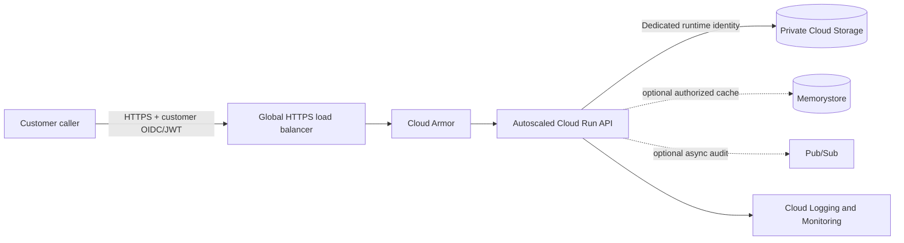

# Customer File Retrieval Service

Assessment project for a customer file retrieval microservice. The target architecture supports 6,000+ requests per second, with a 300 ms latency objective. Stage 1 sets a 99.9% success target; Stage 3 raises that target to 99.99%. These are objectives to measure under representative load, not guarantees made by this sample.

## Presentation solution

### Architecture

**Request path:** caller → HTTPS load balancer with Cloud Armor → autoscaled Cloud Run API → private Cloud Storage bucket.

Cloud Run is the stateless service tier. Its dedicated service account can read files from the private bucket. Cloud Logging and Cloud Monitoring capture operational signals. Memorystore and Pub/Sub are optional additions for authorized hot-file caching and asynchronous work such as audit processing.

The target design and trade-offs are in [docs/architecture.md](docs/architecture.md). Terraform provisions a smaller, directly runnable Cloud Run and private bucket foundation. The Nginx placeholder is public for the demo; set `allow_unauthenticated=false` for the Python deployment. In production, put the service behind the HTTPS load balancer, restrict ingress to it, and use customer-scoped OIDC/JWT authorization.



### Provision the Nginx placeholder

Terraform defaults to `nginx:stable-alpine`, one warm instance, concurrency 80, and a 100-instance maximum. Follow [terraform/README.md](terraform/README.md):

```sh
cd terraform
gcloud auth application-default login
terraform init
terraform fmt -check
terraform validate
terraform plan -var='project_id=YOUR_PROJECT_ID' \
  -var='allow_unauthenticated=true'
terraform apply -var='project_id=YOUR_PROJECT_ID' \
  -var='allow_unauthenticated=true'
```

The public invoker is only for the temporary Nginx placeholder. Disable it for the Python deployment.

### Build and deploy the Python service

The API endpoint is `GET /v1/customers/{customer_id}/files/{file_id}`. It validates path identifiers, checks the `X-API-Key` exercise token, reads from Cloud Storage when `GCS_BUCKET` is configured, and serves a small in-memory fixture locally. Cloud objects above 10 MiB are rejected before download, and storage failures return a generic backend error.

Local run and test commands are in [platform-file-service/README.md](platform-file-service/README.md). The application source and tests are included in the repository.

**Security caveat:** the API key is an exercise stub; it does not authorize a caller for a particular customer. For production, validate a customer identity token, check issuer, audience, expiry, and scope, and derive tenant access from a signed claim. Keep Cloud Run invocation authenticated and restrict service ingress to the load balancer.

### Scaling and SLO validation

Validate 6,000 requests/second and the 300 ms target with representative file sizes, bursts, steady traffic, concurrency, Cloud Storage latency, regional placement, and quota. Measure success rate and the fraction of responses under 300 ms directly; track p95/p99 latency, saturation, and backend errors. Test dependency and regional failures before making an availability claim.

The Terraform scaling values are starting points, not proof of capacity. The service currently buffers files in memory up to 10 MiB; streaming or short-lived authorized download URLs are follow-up work for larger files. The next production steps include customer-scoped OIDC/JWT auth, the global load balancer and Cloud Armor, SLO dashboards/alerts, and multi-region recovery testing.

## Project files

- [Terraform entry point](terraform/main.tf) and [Terraform deployment guide](terraform/README.md)
- [Python application, tests, and local instructions](platform-file-service/README.md)
- [Architecture diagram and design notes](docs/architecture.md)
