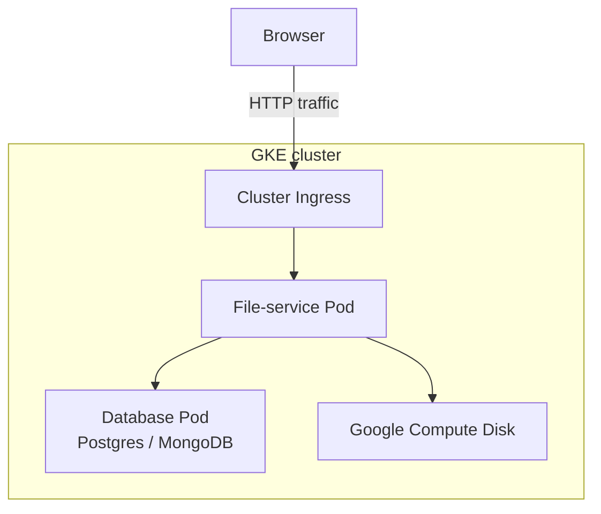
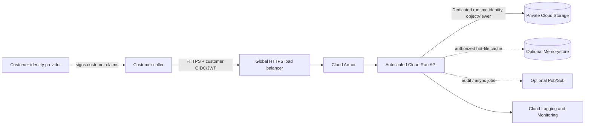

# Architecture and design notes

## How to introduce the supplied diagram

### Supplied starting point

Start by reading the drawing from left to right:

1. **Browser:** the customer initiates a file retrieval request.
2. **HTTP traffic:** the request enters the platform. In a real deployment this should be HTTPS, with authentication checked before the request reaches the service.
3. **GKE cluster and Cluster Ingress:** GKE runs the workloads; Ingress routes an external request to the right internal service. Put the external HTTPS load balancer and Cloud Armor at the edge, before traffic reaches the service; Kubernetes Ingress handles routing into the cluster.
4. **File-service Pod:** this is the API boundary. It should validate the request, authorize the customer, look up file metadata, and retrieve the file.
5. **Database Pod (Postgres/MongoDB):** this appears to hold file metadata and ownership information. It should not be exposed directly to the browser.
6. **Google Compute Disk:** the arrow is ambiguous, so call out the assumption. If it represents shared customer file contents, replace it with private object storage such as Cloud Storage. Keep the database for metadata and use persistent disks only where the database needs block storage. Avoid relying on a pod's local filesystem for durable shared files.

### Interview opening

> “I’ll start with the supplied diagram and follow one request. A customer asks for a file in the browser; the request enters through the cluster ingress and is routed to the file-service pod. The service authenticates the caller, checks that they’re allowed to access that customer’s file, reads metadata from the database, and retrieves the file from storage. The database and storage stay private inside the platform boundary.
>
> “There’s one point I’d clarify in the drawing: the Compute Disk is connected to the file-service pod, so it isn’t clear whether it stores file contents or database data. I’d keep file contents in private object storage and use the database for metadata. That makes the API pods stateless and lets us scale them horizontally. I’d also make the browser connection HTTPS and put edge protection, monitoring, and health-based routing in front of the service.”

Then connect the starter drawing to the submitted implementation:

> “For my assessment implementation I used Cloud Run instead of GKE for the stateless API. The brief allows a choice of platform, and Cloud Run keeps the exercise smaller while still allowing horizontal scaling. The target architecture still includes a global HTTPS load balancer and Cloud Armor; the Terraform provisions a smaller Cloud Run and private-bucket foundation so the exercise is practical to deploy. If the platform requirement were Kubernetes-specific, I’d keep GKE and use multiple API replicas behind the Ingress.”

The starter diagram shows one file-service pod and one database pod. In the target design, the API scales horizontally across zones; database and object storage are managed, private dependencies rather than processes colocated with the API. Treat 6,000+ requests/second and the 300 ms target as load-test criteria, not as a consequence of choosing GKE or Cloud Run.

## Target request path

Terraform provisions Cloud Run, a private bucket, an Artifact Registry repository, and a least-privilege runtime identity. An optional Terraform setting now provisions a global HTTPS load balancer, Cloud Armor WAF policy, managed TLS certificate, and HTTP-to-HTTPS redirect. It requires a hostname with a DNS A record pointing to the load balancer IP. Memorystore, Pub/Sub, and regional failover remain future work.

## Request and storage model

The API endpoint is `GET /v1/customers/{customer_id}/files/{file_id}`. GCS object names are derived as `customers/{customer_id}/{file_id}` after validating both path components. The sample caps GCS downloads at 10 MiB and returns a generic backend error. Without `GCS_BUCKET`, it serves the local `demo-customer/welcome.txt` fixture.

The exercise `X-API-Key` is scoped to one configured customer ID (`API_TOKEN_CUSTOMER_ID`, default `demo-customer`), and the service rejects requests for other customer IDs before reading GCS. This demonstrates a tenant boundary for the one-customer exercise, but is not a production identity system. Production authorization should validate a signed customer OIDC/JWT token, verify issuer, audience, expiry, and scopes, then compare its customer claim with the requested customer before reading GCS. Cache keys must include that authorized tenant identity.

## Design choices and trade-offs

- **Throughput and latency:** Cloud Run is stateless and scales horizontally. The Terraform defaults (one warm instance, concurrency 80, maximum 100) are exercise starting points only. Validate 6,000+ requests/second with actual quotas and representative file sizes, client locations, cache hit ratios, and dependency latency. The sample buffers objects in memory up to 10 MiB; larger files should use streaming or short-lived, tenant-authorized download URLs.
- **Availability:** A global HTTPS load balancer and multi-zone Cloud Run service reduce some regional edge and zone risks. Choose regional or dual-region Storage based on recovery needs. For stronger availability, add active-active regions, explicit failover, tested recovery objectives, and dependency-aware error budgets.
- **Security:** The bucket blocks public access. The Cloud Run identity has object read access only and receives the API token from Secret Manager. Without the optional load balancer, the Python deployment disables public Cloud Run invocation. With the load balancer enabled, Terraform grants the backend invoker role needed by the serverless NEG but restricts Cloud Run ingress to internal and load-balancer traffic; customer authorization remains in the API. The attached Cloud Armor policy enforces low-sensitivity SQLi/XSS WAF rules. Replace the exercise API key with verified customer OIDC/JWT authorization for production.
- **Service separation:** Keep file authorization and retrieval in one small service. Identity issuance belongs to the identity provider; durable files belong in Cloud Storage. Add a separate service only when ownership or scaling needs justify another operational boundary.
- **Async workload:** File reads remain synchronous because a caller needs the response bytes. Publish audit enrichment, scanning, conversion, or uploads to Pub/Sub with idempotent consumers, retries, dead-letter handling, and explicit job status rather than making the read path wait.
- **Caching:** Memorystore may reduce repeated reads for hot objects after authorization. Use tenant-aware cache keys, bounded TTLs, invalidation on object updates, and avoid caching sensitive content unless the policy allows it.
- **Observability:** The sample emits structured request logs with route, status, and duration and avoids logging API keys or file bytes. Cloud Run, load balancer, Cloud Armor, and Storage metrics should feed latency, error-rate, saturation, and SLO burn dashboards and alerts. Add traces and request-size/object-size metrics before production.

## SLO discussion

The architecture stage states 99.9% success and 99.9% within 300 ms. The service stage raises both objectives to 99.99%. Treat these as measured objectives over an agreed window, not guarantees from the sample. Agree how client errors count, measure the fraction under 300 ms directly, and load test steady and burst traffic plus dependency and regional failure scenarios before making a claim.
